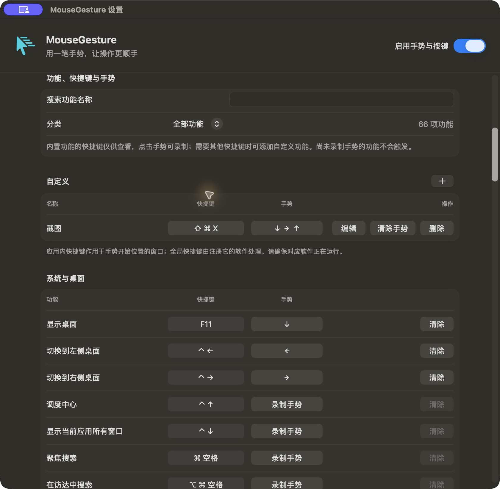
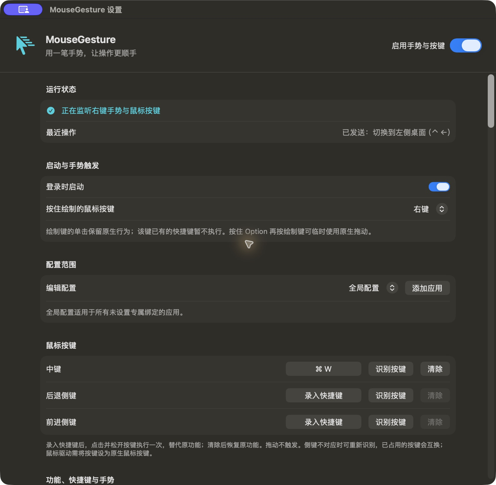

# MouseGesture

[简体中文](README.md) | **English**

MouseGesture is a native macOS mouse gesture tool. Hold the right mouse button, draw a straight line or a sequence of turns, and release to perform an action. You can also draw with the middle or a side button and configure different gestures for individual apps.

It is designed for Mac users who want mouse-driven shortcuts for desktops, windows, browser tabs, and everyday commands.

## Screenshots

View actions, shortcuts, and gestures together. The screenshot shows example bindings; gestures must be recorded during initial setup.

View status and mouse button settings

## Features

- **Custom gesture paths:** Record horizontal or vertical strokes, or paths with up to four segments. Preview recognition and check for conflicts before saving.
- **Action catalog:** Browse system, window, editing, browser, and Finder actions and assign gestures to them.
- **Custom shortcuts:** Name a software action, record its keyboard shortcut, and assign a gesture.
- **Mouse button mapping:** Assign shortcuts to middle, forward, and back buttons, with detection of physical button numbers.
- **Per-app configuration:** Use the same gesture for different actions in different apps; gestures without an app-specific override fall back to global bindings.
- **Window layout:** Move windows to the left or right half, center, maximize, or move them to another display.
- **Trail and reference panel:** Adjust trail color, width, and minimum length, and inspect the current app's effective bindings from the menu bar.
- **Pause and backup:** Exclude apps, temporarily bypass gestures, import or export JSON configuration, and optionally start at login.

### Available actions

| Category | Examples |
| --- | --- |
| System and desktops | Show desktop, switch desktops, Mission Control, Spotlight, lock screen |
| Screenshots and recording | Open the macOS capture toolbar, or take full-screen or region screenshots |
| Windows and apps | Close, minimize, enter full screen, hide, and arrange windows |
| Editing and documents | Cut, copy, paste, undo, find, and save |
| Browsers and tabs | Create and switch tabs, go forward or back, and refresh |
| Finder | Create folders, show file information, Quick Look, and open common locations |

## Download and install

**Requires macOS 13 or later.** Universal packages support Intel and Apple Silicon.

1. Download a DMG or ZIP from [GitHub Releases](https://github.com/black-lattice/MouseGesture/releases/latest).
2. Place `MouseGesture.app` in Applications and open it.
3. Allow MouseGesture in System Settings → Privacy & Security → Accessibility. Allow Input Monitoring too if macOS requests it.
4. Return to settings and confirm that listening is active before configuring gestures.

macOS may block builds without Apple notarization. After verifying the source, allow the app in Privacy & Security.

## Record your first gesture

1. Search for an action, such as Show Desktop, in the action and gesture list (功能、快捷键与手势).
2. Choose Record Gesture (录制手势) on that row and draw in the recording area while holding the drawing button.
3. Release to preview the result, then choose Save Gesture (保存手势). If the path conflicts with another binding, draw another path or clear the original binding first.
4. Return to a window you normally use, draw the same path while holding the drawing button, and release to perform the action.

The right button is the default drawing button. Change it to the middle or a side button in the trigger settings (启动与手势触发). Ordinary clicks retain their native behavior. Actions without a recorded gesture are not triggered.

## Configure your own actions

### Software shortcuts and mouse buttons

Use `+` in Custom (自定义), enter an action name, record a shortcut and gesture, then save. For example, bind a running app's play/pause shortcut. The name identifies the configuration; it does not launch software.

In Mouse Buttons (鼠标按键), record shortcuts for the middle or side buttons. A binding replaces that button's native click action; clearing it restores the original behavior. If a side button is not recognized correctly, use Detect Button (识别按键) and press the physical button.

Built-in action shortcuts are read-only. Create a custom action if you need a different combination. Enable the corresponding shortcut in the system or target app; MouseGesture sends the action but cannot confirm its final result.

### Per-app configuration

Select the global configuration in Configuration Scope (配置范围), or choose Add App (添加应用) and select an `.app`. An app-specific gesture takes priority over a global binding with the same path; other paths use the global configuration. Side buttons can also be configured separately, with Restore Global Binding (恢复全局绑定) to resume inheritance.

### Pause and back up

- For games, 3D software, or native right-button dragging, hold Option before pressing the drawing button to bypass gestures temporarily, or add the app to the exclusion list.
- Press Esc, another key, or the left mouse button while drawing to cancel the gesture.
- Export JSON in Configuration Backup (配置备份). Import using merge or replace. The file includes global and per-app bindings, excluded apps, the drawing button, and trail appearance. Login items are configured separately on each computer.

## Privacy and usage notes

- Built with native Swift, SwiftUI, and AppKit. Configuration stays locally. The app does not read screen contents, upload trails, make network requests, or require Screen Recording permission.
- Horizontal and vertical strokes and turns are supported; diagonal lines, circles, and arbitrary curves are not. No gestures are assigned on first use.
- Window actions target the window at the gesture's starting point. Finder actions apply only in Finder windows; other shortcuts depend on the target app's support.
- Switching desktops requires multiple desktops. Maximizing is different from system full screen, and moving between displays requires multiple displays.
- Mouse buttons already converted into keyboard combinations by a mouse driver cannot be remapped through mouse button detection.
- The app remains in the menu bar after its settings window closes. You can pause or quit it there.

## Feedback

Report problems or suggest features through [GitHub Issues](https://github.com/black-lattice/MouseGesture/issues).

[MIT License](LICENSE)
