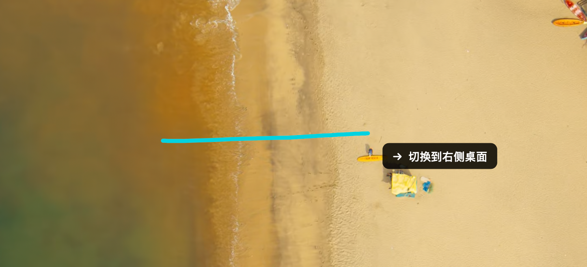
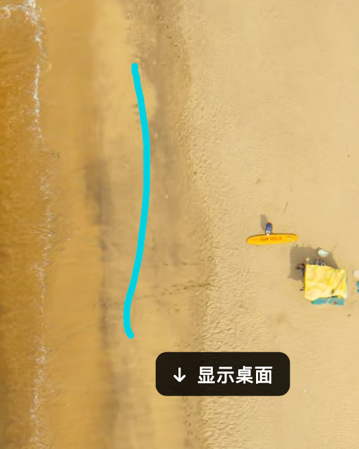
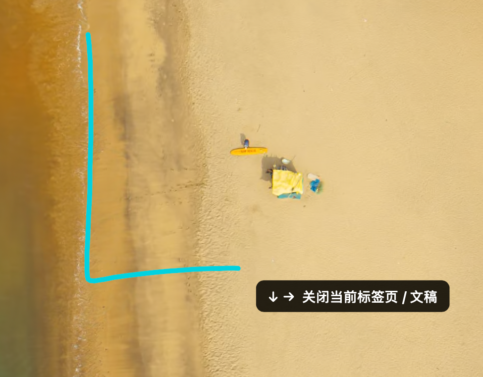
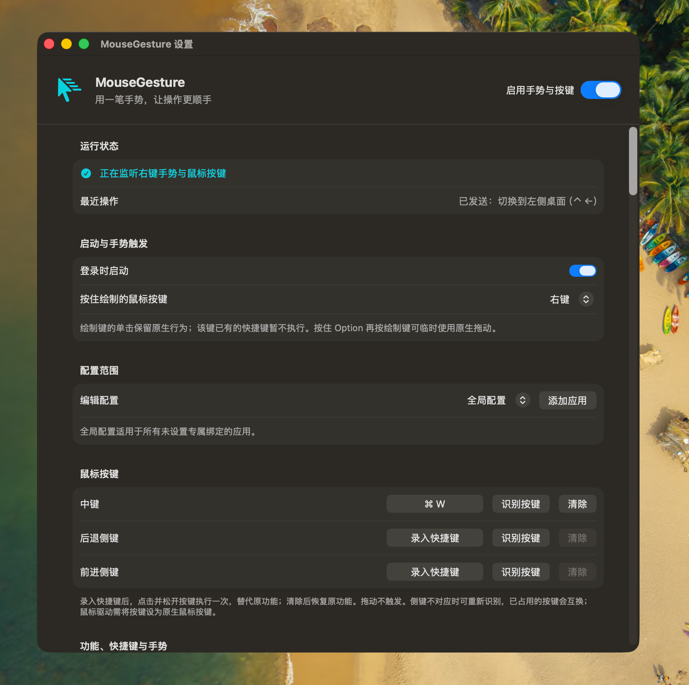

# MouseGesture

**简体中文** | [English](README.en.md)

MouseGesture 是原生 macOS 鼠标手势工具。按住右键画出一笔直线或折线，松开即可执行对应操作；也可使用中键或侧键绘制，并为不同应用配置专属手势。

适合希望用鼠标快速切换桌面、管理窗口、操作浏览器和执行常用快捷键的 Mac 用户。

## 界面预览

绘制时显示实时轨迹，停顿时提示匹配的操作，松开执行。下图为已配置的手势示例，首次使用需要自行录制手势。

**向右绘制，切换到右侧桌面。**

| 向下绘制：显示桌面 | 向下再向右绘制：关闭当前标签页 / 文稿 |
| --- | --- |
|  |  |

### 设置界面

查看运行状态，选择手势绘制键，管理全局或应用专属配置，并为中键和侧键绑定快捷键。

## 核心功能

- **自定义轨迹**：录制上下左右直线或最多四段折线，实时预览识别结果并检查冲突。
- **常用操作目录**：按分类查找系统、窗口、编辑、浏览器和访达功能，再为其绑定手势。
- **自定义快捷键**：为软件功能填写名称、录入快捷键并录制手势。
- **鼠标按键映射**：为中键、前进和后退侧键分别绑定快捷键，支持识别实际按键编号。
- **应用专属配置**：相同手势在不同应用中执行不同操作，未覆盖的手势回退到全局配置。
- **窗口布局**：左半屏、右半屏、居中、最大化或移到另一块显示器。
- **轨迹与速查**：调整轨迹颜色、粗细和最短长度，从菜单栏查看当前应用的有效绑定。
- **暂停与备份**：排除指定应用、临时绕过手势，导入或导出 JSON 配置，支持登录启动。

### 可绑定的操作

| 分类 | 功能示例 |
| --- | --- |
| 系统与桌面 | 显示桌面、切换桌面、调度中心、聚焦搜索、锁屏 |
| 截屏与录屏 | 调用 macOS 截屏工具栏、全屏或区域截图 |
| 窗口与应用 | 关闭、最小化、全屏、隐藏和调整窗口布局 |
| 编辑与文稿 | 剪切、复制、粘贴、撤销、查找、保存 |
| 浏览器与标签页 | 新建与切换标签页、前进、后退、刷新 |
| 访达 | 新建文件夹、文件简介、快速查看和打开常用位置 |

## 下载与安装

**系统要求：macOS 13 或更新版本。** Universal 安装包同时支持 Intel 和 Apple Silicon。

1. 从 [GitHub Releases](https://github.com/black-lattice/MouseGesture/releases/latest) 下载 DMG 或 ZIP。
2. 将 `MouseGesture.app` 放入「应用程序」并打开。
3. 在「系统设置 → 隐私与安全性 → 辅助功能」中允许 MouseGesture；若系统提示输入监控权限，也需允许。
4. 回到设置确认正在监听，再开始配置手势。

从 v0.3.1 起，点击菜单栏的 MouseGesture 图标，选择「检查更新」即可安装新版，也可以允许 Sparkle 定期检查。首次安装或从 v0.3.0 及更早版本升级时，请先安装一次 GitHub Releases 提供的通用安装包。

未经过 Apple 公证的安装包可能被系统拦截。确认来源后，可在「隐私与安全性」中允许打开。

## 录制第一个手势

1. 在「功能、快捷键与手势」中搜索功能，例如“显示桌面”。
2. 点击同一行的「录制手势」，在录制区域按住绘制键画出轨迹。
3. 松开查看识别结果，点击「保存手势」。重复轨迹会提示冲突，需要重新绘制或先清除原绑定。
4. 回到日常使用的窗口，按住绘制键画出相同轨迹，松开执行。

默认绘制键为右键，可在「启动与手势触发」中改为中键或侧键。普通点击保留原生行为；未录制的功能不会触发。

## 配置自己的操作

### 软件快捷键与鼠标按键

在「自定义」中点击「＋」，填写名称、录入快捷键、录制手势，再点击「保存」。例如为正在使用的软件绑定“播放 / 暂停”；功能名称用于识别配置，不会据此启动软件。

在「鼠标按键」中可为中键或侧键单独录入快捷键。绑定后会替代该按键的原生单击操作，清除后恢复。侧键编号不匹配时，使用「识别按键」并按一下实际按键。

内置功能的快捷键只读；需要不同组合时请创建自定义功能。系统或目标软件需要启用相应快捷键，应用只能发送操作，不能确认其最终执行结果。

### 应用专属配置

在「配置范围」中选择全局配置，或点击「添加应用」选择 `.app`。应用专属手势优先于全局同轨迹绑定；未覆盖的轨迹使用全局配置。侧键也可单独配置，并通过「恢复全局绑定」恢复继承。

### 临时暂停与配置备份

- 游戏、3D 软件或需要原生右键拖拽时，可先按住 Option 再按绘制键临时绕过，或将应用加入排除列表。
- 绘制中按 Esc、其他键或鼠标左键可取消本次手势。
- 在「配置备份」导出 JSON，导入时选择合并或覆盖。文件包含全局与应用专属绑定、排除列表、绘制键和轨迹外观；登录项需在本机设置。

## 隐私与使用须知

- 原生 Swift、SwiftUI 与 AppKit 应用；配置保存在本机，不读取屏幕内容、不上传轨迹、无网络请求，也不需要录屏权限。
- 支持直线和折线，不支持斜线、圆形等自由曲线；首次使用不预设手势。
- 窗口操作作用于手势起点所在窗口；访达操作仅在访达窗口中生效，其他快捷键依赖目标应用支持。
- 切换桌面需要已有多个桌面，最大化不等于系统全屏，跨屏移动需要多块显示器。
- 被鼠标驱动转换为键盘组合的按键，不能通过鼠标按键识别入口重新映射。
- 关闭设置窗口后仍在菜单栏运行，可随时暂停或退出。

## 反馈

遇到问题或有功能建议，欢迎提交 [Issue](https://github.com/black-lattice/MouseGesture/issues)。

[MIT License](LICENSE)
